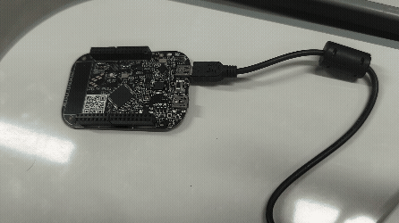

# Pisca LED com RTOS

## Configuração do LED
Foi feito um código com duas threads, uma para o led azul e outra para o led verde. Dessa maneira, os dois leds podem ser controlados paralelamente.

 

Como as duas threads vão sendo executadas de forma paralela, dessa maneira para realizar o desafio proposto basta mudar o intervalo que o segundo LED pisca para 350 ms.
